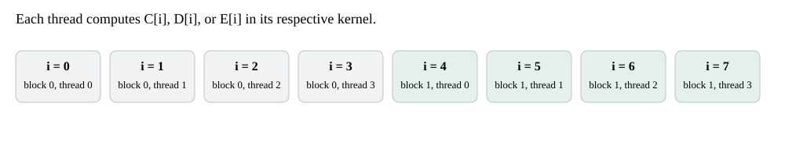
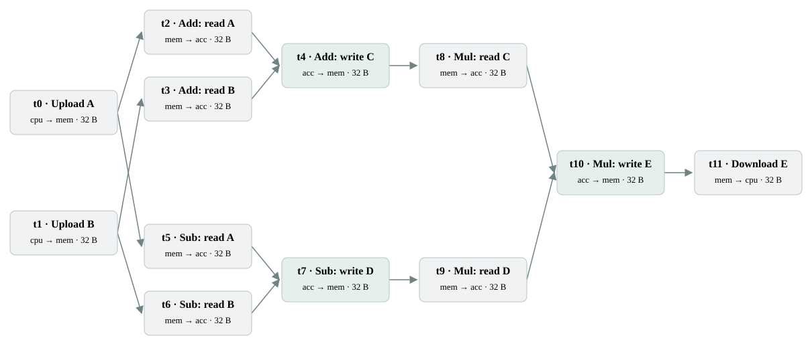
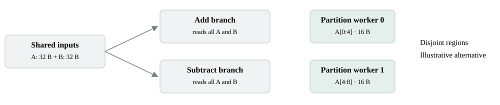
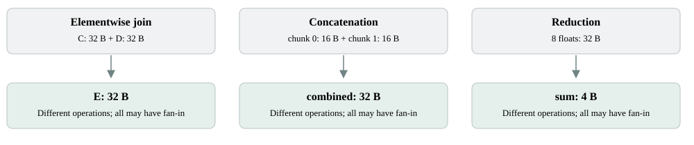
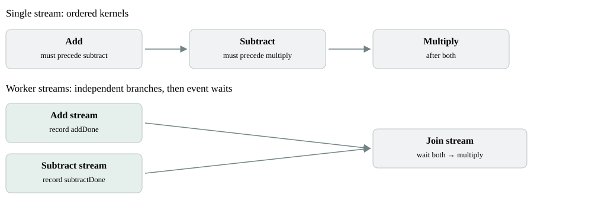
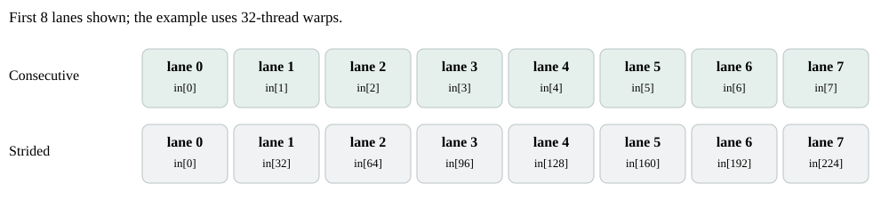

# From CUDA code to a data-dependency graph

A 10–15 minute walkthrough. Open **presentation.html** in a browser, use the arrow keys to move between sections, and toggle **Speaker notes** when presenting. Print to PDF for a static copy. The runnable CUDA examples and generated JSONs are included alongside this guide.

The central distinction: **our graph describes logical transfers and prerequisites; execution scheduling and hardware efficiency need additional information.**

## 1. Start with one small computation

We compute eight independent output elements:

```cpp
C[i] = A[i] + B[i];
D[i] = A[i] - B[i];
E[i] = C[i] * D[i];
```

With A[i] = 3 and B[i] = 1, C[i] = 4, D[i] = 2, and E[i] = 8. These are expected values from the equations; we have not run these teaching variants on a GPU.

Each array has **8 float32 elements × 4 bytes = 32 bytes**. C and D can be computed independently once A and B are available. E needs both results.

The full runnable examples are [single_stream.cu](examples/single_stream.cu) and [explicit_streams.cu](examples/explicit_streams.cu). They are small variants of the existing repository examples, matched in size and input values.

> Say: “I will distinguish three things: the computation, the transfer graph we export, and how CUDA may schedule that computation.”

## 2. The CUDA code expresses element-level work

```cpp
__global__ void vectorAdd(const float *A, const float *B, float *C, int N) {
    int i = blockIdx.x * blockDim.x + threadIdx.x;
    if (i < N) C[i] = A[i] + B[i];
}
__global__ void vectorSub(const float *A, const float *B, float *D, int N) {
    int i = blockIdx.x * blockDim.x + threadIdx.x;
    if (i < N) D[i] = A[i] - B[i];
}
__global__ void vectorMul(const float *C, const float *D, float *E, int N) {
    int i = blockIdx.x * blockDim.x + threadIdx.x;
    if (i < N) E[i] = C[i] * D[i];
}
```

The host allocates A–E, uploads A and B, launches these kernels, then downloads E. The single-stream teaching code uses **N = 8, threads = 4, blocks = 2** for easy explanation; this is not a performance tuning choice.

> Say: “A CUDA thread computes one index. There is no dependence between different indices in this example.”

## 3. Where is the work divided?

<!-- THREADS -->



Block 0 handles indices 0–3; block 1 handles indices 4–7. Within each block, threadIdx.x selects one of four elements. The work is divided by indices; there is no extra array-copy operation at the block boundary.

This is **data parallelism inside a kernel**. The exported graph aggregates those accesses into one read transfer per input buffer and one write transfer per output buffer. It has no node for each thread, block, or warp.

The four-thread blocks are deliberately tiny. They do not imply that a CUDA warp has four threads. CUDA groups threads into warps of 32; active threads and available GPU resources determine execution. [NVIDIA SIMT documentation](https://docs.nvidia.com/cuda/archive/13.1.1/cuda-programming-guide/02-basics/writing-cuda-kernels.html).

> Say: “The code divides the element work across threads. Our graph collapses that work back into buffer footprints, so this form of parallelism is hidden inside a transfer node.”

## 4. The graph we actually generated

<!-- DAG -->



Both teaching sources were analyzed with our Clang-based exporter. **Both produce exactly the same simulator JSON: 12 nodes, 13 edges, and 32 bytes per node.** The source metadata differs.

Each box is a logical transfer. Each arrow is a prerequisite. Horizontal position is dependency depth, **not elapsed time**. This is our simulator-input DAG, not a CUDA Graph API execution graph.

**cpu → mem** is an upload; **mem → acc** is a kernel input footprint; **acc → mem** is a kernel output footprint; **mem → cpu** is a download. `mem` and `acc` are abstract simulator components, not claims about a specific cache or bus.

> Say: “These are not three kernel boxes. Each kernel is expanded into logical input reads and output writes, with no separate compute-duration node.”

## 5. Read the graph back into the code

- **t0, t1:** upload A and B, 32 bytes each.
- **t2, t3 → t4:** vectorAdd reads A and B, then writes C; all three transfers are 32 bytes.
- **t5, t6 → t7:** vectorSub reads A and B, then writes D; all three transfers are 32 bytes.
- **t4 → t8** and **t7 → t9:** the final kernel reads C and D only after their producers finish.
- **t8, t9 → t10 → t11:** the output write E waits for both input reads; the host download waits for E.

The exact edges are `0→2, 0→5, 1→3, 1→6, 2→4, 3→4, 4→8, 5→7, 6→7, 7→9, 8→10, 9→10, 10→11`.

There are **96 logical host/device copy bytes**: 64 uploaded + 32 downloaded. The remaining 288 bytes are kernel read/write footprints. Summing all nodes gives 384 logical bytes, **not 384 measured DRAM bytes or PCIe bytes**. It also does not include protocol overhead.

> Say: “A is uploaded once, but two kernels consume it. Therefore the graph contains one upload of A and two separate logical reads of A. Cache reuse could change physical traffic without changing this graph.”

## 6. A fork is not necessarily a partition

<!-- SPLIT -->



**Our generated example: shared-input fork.** Both branches read all eight elements of A and B. The computation forks; neither input array is divided into halves between branches. Two readers do not create a read/write hazard with each other.

**Different, illustrative case: partitioned input.** A worker processes A[0:4] and another processes A[4:8]. Each half contains 16 bytes. This can use two allocations or disjoint regions of one allocation; it does not inherently require copying data into new buffers.

Our default affine examples use conservative whole-buffer dependencies. The configured analyzer has an opt-in byte-region mode for supported cases: it can distinguish disjoint regions and track overlapping-byte hazards. This does not imply arbitrary slicing/pointer code is supported. The partition picture is conceptual, not an additional generated graph in this package.

If accesses overlap, a read waits for the previous writer (RAW); a new write waits for relevant earlier readers (WAR) and writers (WAW). Two reads alone do not impose such a hazard. These rules depend on the analyzer’s buffer/region granularity and supported synchronization checks.

A stencil partition may need overlapping neighbor regions, or “halos.” Then the two read footprints overlap even when their output regions are disjoint.

> Say: “Look at the addresses each branch uses. Two arrows leaving a node do not prove that the array has been cut into two pieces.”

## 7. What does it mean for data to come together?

<!-- JOIN -->



**Elementwise join — our actual code:** C has 8 floats and D has 8 floats; vectorMul reads both and writes E with 8 floats. That is **64 input bytes → 32 output bytes**. It combines values, not concatenates arrays. In this transfer DAG the explicit two-input wait is at t10, after t8 and t9.

**Concatenation — illustrative:** two 4-float chunks become an 8-float output: **16 + 16 → 32 bytes**. This preserves all elements in a larger combined sequence.

**Reduction — illustrative:** eight floats are summed into one float: **32 → 4 bytes**. A buffer-level graph can show the size change, but it does not reveal the thread/block reduction tree, arithmetic operations, or internal synchronization.

Call these a **join**, **concatenation**, or **reduction**. “Memory coalescing” means something different in CUDA.

> Say: “An incoming pair of edges tells us that both inputs must be ready. The operation name and source tell us whether values are multiplied, concatenated, or reduced; the bare simulator schema does not.”

## 8. Potential parallelism versus CUDA scheduling

<!-- STREAMS -->



In **single_stream.cu**, all three kernels use the same default stream. The add launch precedes subtract, then multiply. These kernels are ordered even though add and subtract have no data dependence.

In **explicit_streams.cu**, add and subtract use separate nonblocking streams. Uploads are completed before launching them. Each branch records an event; the join stream waits for both events before launching the final kernel. These branches may overlap, but overlap is not guaranteed.

CUDA stream order is an execution constraint beyond data dependence. Different streams permit concurrency subject to hardware resources. [NVIDIA streams and asynchronous execution](https://docs.nvidia.com/cuda/cuda-programming-guide/02-basics/asynchronous-execution.html).

The matched examples have **identical transfer JSONs**. Explicit-stream metadata records stream identities and operation ordering. A simulator that reads only the transfer DAG cannot distinguish these scheduling choices or assume an observed speedup. Eight-element examples are teaching cases, not useful concurrency benchmarks.

> Say: “No dependency means data independence in this model. It does not mean the GPU actually executed the two branches simultaneously.”

## 9. Memory coalescing is about addresses within a warp

<!-- COALESCING -->



Consider a separate, illustrative 1,024-element copy. The first line reads consecutive input elements; the second permutes the same input elements:

```cpp
// Thread indices i = 0..1023; these are illustrative access expressions.
out[i] = in[i];
// Alternative input mapping, not an extra statement in the same kernel:
int j = (i % 32) * 32 + i / 32;
out[i] = in[j];
```

Across all threads, both mappings cover the same 1,024 input and output floats: **4,096 bytes read + 4,096 bytes written**. Within a warp, the input addresses differ: consecutive versus a 32-float stride. Adjacent suitable accesses can be served with fewer memory transactions; access size, alignment, active lanes, and GPU architecture matter. [NVIDIA memory-coalescing guidance](https://docs.nvidia.com/cuda/cuda-c-best-practices-guide/index.html#coalesced-access-to-global-memory).

Our graph retains unique buffer footprints, not lane-to-address mappings or transaction counts. It cannot distinguish these access efficiencies from volumes alone. This permutation is an explanatory example, not a claim that the affine exporter supports this expression. No transaction count or bandwidth was measured here.

> Say: “A logical footprint tells us which bytes are needed in total. Coalescing depends on which lanes ask for which bytes together. That information is lost when we aggregate.”

## 10. What is present, and what is missing?

**In the simulator JSON:** transfer IDs; logical byte volumes; abstract source/destination components; directed prerequisite edges. For supported source/configuration cases these capture input/output flow, joins, and modeled memory hazards.

**In accompanying metadata/source, not generally in the simulator JSON:** buffer names and kernel stages; source fingerprints and assumptions; explicit-stream operation ordering where supported; byte ranges and launch dimensions in configured analyses. Metadata fields vary by analysis path. The CUDA source still contains the arithmetic and indexing that aggregation discards.

**Not represented as performance behavior:** compute duration/FLOPs; occupancy and resource usage; warp/thread scheduling; lane-level coalescing; cache hits and physical DRAM transactions; internal shared-memory movement; bandwidth/latency/contention policies; actual overlap; launch overhead; a full CPU execution timeline; arbitrary runtime-dependent paths.

Whole-transfer readiness is conservative: it can hide finer per-element pipelining inside a kernel. Neither a node nor an edge encodes the arithmetic operator or its latency.

The graph is not a proof of numerical correctness or simulator compatibility. The newer tiled Rodinia graphs additionally assume valid internal shared-memory synchronization; their bounds/global footprints are checked, but barrier correctness is not simulated.

> Say: “Some details are in metadata but are absent from the simulator input. Others, such as cache behavior and execution latency, have not been modeled at all.”

## 11. What can the simulator conclude?

The DAG gives a **partial order of modeled transfers**. It identifies prerequisites and candidates for independent work. A fan-in identifies a wait for multiple inputs. A graph level is not a time unit, and an edge may enforce a memory-reuse hazard rather than carry data itself.

To estimate runtime, the simulator must additionally define component mapping, transfer latency/bandwidth, contention, compute costs, launch/scheduling rules, and completion across all required work. If it needs CUDA fidelity, it must also account for stream/event constraints. A dependency graph alone cannot yield a reliable GPU runtime or speedup.

Copy/compute pipelining is another form of parallelism: uploading chunk k+1 while computing chunk k and downloading chunk k−1. It needs a suitable CUDA implementation and hardware. Neither teaching example demonstrates such a pipeline; their host copies are blocking.

For validation, compare the supported source's logical accesses against the graph first. A GPU is not needed for that check. Measuring runtime, actual overlap, or hardware traffic is a separate exercise.

> Say: “This graph is an input to a performance model. It is not itself a performance measurement or a complete model of a GPU.”

## 12. Closing explanation and questions

**Suggested closing:** “We start with CUDA source and aggregate supported accesses into logical transfers. The graph preserves bytes and prerequisites: what needs to be available before another transfer proceeds. It can expose independent branches and joins. It does not, by itself, tell us how CUDA schedules those branches or how efficiently the GPU moves those bytes.”

- **Does a fork split an array?** Only if the source accesses distinct regions. Our main example shares full inputs.
- **Does a join concatenate data?** Not necessarily. Here it multiplies corresponding C and D values.
- **Do independent nodes execute at the same time?** Not necessarily; scheduling and resources still constrain execution.
- **Does “32 bytes read” mean 32 bytes from DRAM?** No. It is a logical unique footprint.
- **Can two different implementations have the same graph?** Yes: our two generated examples do, despite different stream constraints.
- **Is a GPU needed to generate this graph?** No. Python and Clang suffice; GPU execution is a separate validation track.

> Say: “The next improvement depends on what we want to predict: scheduling needs stream constraints; memory efficiency needs address/transaction information; runtime needs compute and resource costs.”

## Reproduce and verify

From the repository root:

```bash
python3 export_workload_transfers.py \
  --source docs/cuda-graph-walkthrough/examples/single_stream.cu \
  --out-dir docs/cuda-graph-walkthrough/generated
python3 export_workload_transfers.py \
  --source docs/cuda-graph-walkthrough/examples/explicit_streams.cu \
  --out-dir docs/cuda-graph-walkthrough/generated
python3 -B docs/cuda-graph-walkthrough/verify.py
```

The presentation's detailed DAG is drawn directly from the generated single-stream JSON and metadata. Thread, partition, join, scheduling, and coalescing illustrations are labeled conceptual; they are not measured timelines or additional exporter results. No CUDA executable, GPU profiler, or simulator was run for this walkthrough.

The two teaching files change only input size/block size and, for the stream example, use matching constant inputs. Their parent examples are [fork_join.cu](../../workloads/fork_join.cu) and [fork_join_streams.cu](../../workloads/fork_join_streams.cu).
